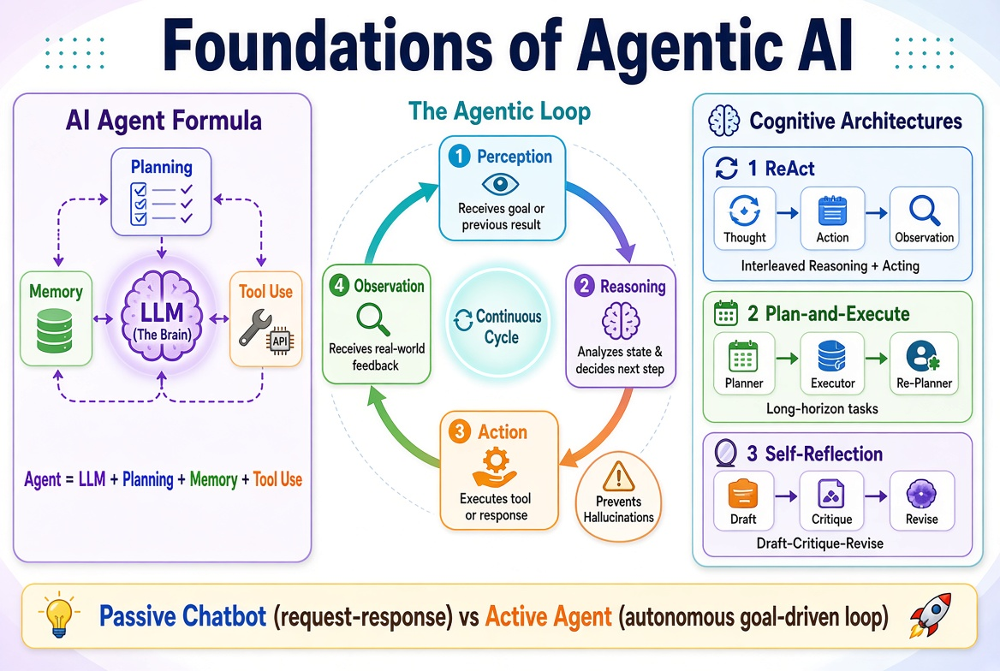

# Foundations of Agentic AI

!!! info "Learning Objectives"
    By the end of this chapter, you will be able to:
    - Define an AI Agent and identify its four core components.
    - Explain the Perception-Reasoning-Action-Observation loop.
    - Distinguish between passive chatbots and active agents.
    - Implement and compare ReAct, Plan-and-Execute, and Self-Reflection architectures.

## Overview

The evolution of Large Language Models (LLMs) has shifted from simple text generation to the creation of autonomous agents. While a standard LLM acts as a sophisticated autocomplete system, an AI Agent uses the LLM as a reasoning engine to interact with the world, use tools, and achieve complex goals independently. This chapter explores the architectural foundations that enable this transition from passive response to active agency.



## What is an AI Agent?

An AI Agent is an autonomous system that employs an LLM as its central coordination hub ("the brain") to solve general problems by interacting with an environment.

### The Agent Formula

The capability of an agent is typically defined by the integration of four components:

Agent = LLM + Planning + Memory + Tool Use

- **LLM (The Brain)**: Provides the core reasoning, linguistic understanding, and decision-making logic.
- **Planning**: The ability to decompose a complex goal into a sequence of smaller, manageable sub-tasks.
- **Memory**: The mechanism for storing and retrieving information. This includes short-term memory (the context window) and long-term memory (external vector databases).
- **Tool Use**: The capacity to execute external functions, such as calling an API, searching the web, or running a Python script.

### Passive vs. Active AI

The fundamental difference between a chatbot and an agent lies in the nature of the interaction loop.

- **Passive AI (Chatbot)**: Operates in a request-response mode. The user provides a prompt, and the AI provides an answer. The interaction ends once the response is generated.
- **Active AI (Agent)**: Operates in an autonomous loop. The user provides a goal, and the agent determines the necessary steps, selects the appropriate tools, and verifies the results until the goal is achieved.

!!! note "Why this matters"
    This shift transforms the role of AI from a "consultant" that provides information into an "operator" that executes tasks. In an enterprise context, this means moving from an AI that tells you how to update a database to an AI that actually performs the update and verifies the result.

## The Agentic Loop

Agentic behavior is driven by a continuous cycle of perception and action. This cycle allows the agent to adjust its strategy based on real-world feedback.

The loop follows this sequence:
**Perception $\rightarrow$ Reasoning $\rightarrow$ Action $\rightarrow$ Observation**

1. **Perception**: The agent receives an initial goal from the user or observes the output of a previous action.
2. **Reasoning**: The agent analyzes the current state, reflects on the goal, and decides on the next step.
3. **Action**: The agent executes a specific operation, such as calling a tool or generating a response.
4. **Observation**: The agent perceives the result of the action (e.g., the data returned by an API) and feeds it back into the Perception phase.


Figure 1: The fundamental agentic loop of perception, reasoning, action, and observation.

!!! warning "The Hallucination Trap"
    Without the Observation phase, agents rely solely on the LLM's internal weights. This often leads to hallucinations where the agent "imagines" a tool response. A robust agent must always wait for a concrete Observation before proceeding to the next Reasoning step.

## Cognitive Architectures

Different goals require different reasoning patterns. Three primary architectures dominate the current landscape: ReAct, Plan-and-Execute, and Self-Reflection.

### ReAct (Reason + Act)

ReAct is the core pattern for agents that need to interact with dynamic environments. It interleaves reasoning traces (Thoughts) with actions.

**The ReAct Cycle**:
- **Thought**: "I need to find the current price of NVIDIA stock to answer the user."
- **Action**: `get_stock_price("NVDA")`
- **Observation**: "NVDA is trading at $135.20."
- **Thought**: "I have the price. I can now provide the final answer."
- **Final Answer**: "NVIDIA is currently trading at $135.20."

!!! note "Why this matters"
    ReAct prevents the LLM from jumping to a conclusion. By forcing the model to write a "Thought" before an "Action," the agent creates a reasoning trace that grounds the final answer in evidence.

#### Implementation: Manual ReAct Loop

The following example demonstrates a simplified ReAct agent that uses a weather tool.

```python
def mock_get_weather(city):
    """Simulates an external weather API."""
    weather_data = {"New York": "Sunny, 22C", "London": "Rainy, 15C"}
    return weather_data.get(city, "Weather unknown")

def run_react_agent(user_goal):
    """
    A simplified ReAct loop. In a production system, 
    the 'LLM' parts would be calls to an API.
    """
    print(f"Goal: {user_goal}")
    
    # Step 1: Reasoning & Action
    thought_1 = "I need to check the weather for London to answer the user."
    action_1 = "get_weather: London"
    print(f"Thought: {thought_1}")
    print(f"Action: {action_1}")
    
    # Step 2: Observation
    observation_1 = mock_get_weather("London")
    print(f"Observation: {observation_1}")
    
    # Step 3: Final Reasoning & Answer
    thought_2 = "I now know the weather in London is rainy and 15C."
    final_answer = "The weather in London is rainy and 15C."
    print(f"Thought: {thought_2}")
    print(f"Final Answer: {final_answer}")

run_react_agent("What is the weather in London?")
```

### Plan-and-Execute

ReAct can fail on complex tasks because the agent may "forget" the original goal while focusing on immediate observations. Plan-and-Execute separates high-level strategy from low-level execution.

**The Process**:
1. **Planner**: Decomposes the goal into a static list of sub-tasks.
2. **Executor**: Executes each task sequentially using a ReAct-style loop.
3. **Re-Planner**: After each task, the agent evaluates if the original plan is still valid and updates it if necessary.

**Scenario**: "Research the top 3 competitors of CloudMesh and write a summary report."
- **Plan**:
    1. Search for CloudMesh competitors.
    2. Identify the core value proposition of each.
    3. Compare the three competitors across pricing and features.
    4. Synthesize a final report.

!!! tip "When to use Plan-and-Execute"
    Use this architecture for "long-horizon" tasks where the agent must maintain focus over many steps. It is significantly more stable than pure ReAct for multi-step research or coding projects.

### Self-Reflection

Self-Reflection (or Reflexion) is an iterative process where the agent critiques its own output to improve the quality of the result.

**The Reflection Loop**:
**Draft $\rightarrow$ Critique $\rightarrow$ Revise**

1. **Draft**: The agent generates an initial solution.
2. **Critique**: The agent (or a separate critic model) analyzes the draft for errors, inefficiencies, or missing requirements.
3. **Revise**: The agent uses the critique to produce an improved version.

#### Implementation: The Reflection Pattern

This pattern is particularly effective for code generation and technical writing.

```python
def draft_code(prompt):
    """Generates an initial implementation."""
    return "def add(a, b): return a + b"

def critique_code(code):
    """Analyzes the code for improvements."""
    return "The function works but lacks type hints for better maintainability."

def refine_code(original, critique):
    """Produces a revised version based on critique."""
    return "def add(a: int, b: int) -> int: return a + b"

# Execution of the reflection loop
prompt = "Write a simple addition function."
initial_draft = draft_code(prompt)
critique = critique_code(initial_draft)
final_version = refine_code(initial_draft, critique)

print(f"Draft: {initial_draft}")
print(f"Critique: {critique}")
print(f"Final: {final_version}")
```

!!! note "Why this matters"
    Reflection mimics the human cognitive process of "proofreading." It significantly reduces the error rate in complex reasoning tasks by allowing the model to recognize its own mistakes in a second pass.

## Summary Checklist

- [ ] Defined an AI Agent as the combination of LLM, Planning, Memory, and Tool Use.
- [ ] Explained the difference between passive chatbots and active agents.
- [ ] Described the four stages of the agentic loop: Perception, Reasoning, Action, and Observation.
- [ ] Implemented a basic ReAct cycle.
- [ ] Differentiated between ReAct and Plan-and-Execute for long-horizon tasks.
- [ ] Applied the Draft-Critique-Revise cycle of Self-Reflection.

## Assignments

!!! note "Implement a Tool-Using Agent"
    Create a Python script that simulates a ReAct agent. The agent should have access to two mock tools: `get_user_email(username)` and `send_email(email, message)`. The agent should be able to take a goal like "Send a welcome email to user 'jdoe'" and execute the correct sequence of Thought, Action, and Observation.
    
    ??? question "Solution"
        ```python
        def get_user_email(username):
            users = {"jdoe": "jdoe@example.com"}
            return users.get(username, "User not found")

        def send_email(email, message):
            print(f"Email sent to {email}: {message}")
            return "Success"

        def simple_agent(goal):
            # Simulated LLM reasoning
            print("Thought: I need to find the email for jdoe.")
            email = get_user_email("jdoe")
            print(f"Observation: {email}")
            
            print("Thought: I have the email. Now I will send the welcome message.")
            result = send_email(email, "Welcome to the platform!")
            print(f"Observation: {result}")
            print("Final Answer: The welcome email has been sent to jdoe@example.com.")

        simple_agent("Send a welcome email to user 'jdoe'")
        ```

!!! note "Refactor to Plan-and-Execute"
    Take the "Welcome Email" agent from the previous assignment and refactor it into a Plan-and-Execute architecture. The agent should first generate a list of steps (the plan) before executing them.
    
    ??? question "Solution"
        ```python
        def get_user_email(username):
            return "jdoe@example.com"

        def send_email(email, message):
            return "Success"

        def plan_and_execute(goal):
            # 1. Planning Phase
            plan = [
                "Find email for user jdoe",
                "Send welcome message"
            ]
            print(f"Plan: {plan}")
            
            # 2. Execution Phase
            for step in plan:
                if "Find email" in step:
                    email = get_user_email("jdoe")
                    print(f"Executed {step}: {email}")
                elif "Send welcome" in step:
                    res = send_email(email, "Welcome!")
                    print(f"Executed {step}: {res}")
            
            print("Goal achieved.")

        plan_and_execute("Send a welcome email to user 'jdoe'")
        ```

## References

- Weng, L. (2023). LLM Powered Autonomous Agents. [https://lilianweng.github.io/posts/2023-06-23-agent/](https://lilianweng.github.io/posts/2023-06-23-agent/)

## Self-Evaluation

??? note "What are the four components of the AI Agent formula?"
    The four components are the LLM (the reasoning engine), Planning (decomposition of goals), Memory (short and long term storage), and Tool Use (external API/function calls).

??? note "How does an AI Agent differ from a standard chatbot?"
    A chatbot is passive, operating in a request-response mode. An agent is active, operating in a loop where it can perceive, reason, and act autonomously until a goal is reached.

??? note "What is the purpose of the Observation phase in the agentic loop?"
    The Observation phase provides real-world feedback from the action taken. This grounds the agent's reasoning in actual data, preventing hallucinations and allowing the agent to correct its path.

??? note "When is Plan-and-Execute preferable to a pure ReAct loop?"
    Plan-and-Execute is better for long-horizon tasks. It prevents the agent from losing sight of the overall goal by separating the high-level strategy (the plan) from the low-level execution.

??? note "Describe the three steps of the Self-Reflection pattern."
    The steps are: 1. Draft (generate an initial solution), 2. Critique (analyze the draft for errors or improvements), and 3. Revise (generate a new version based on the critique).
