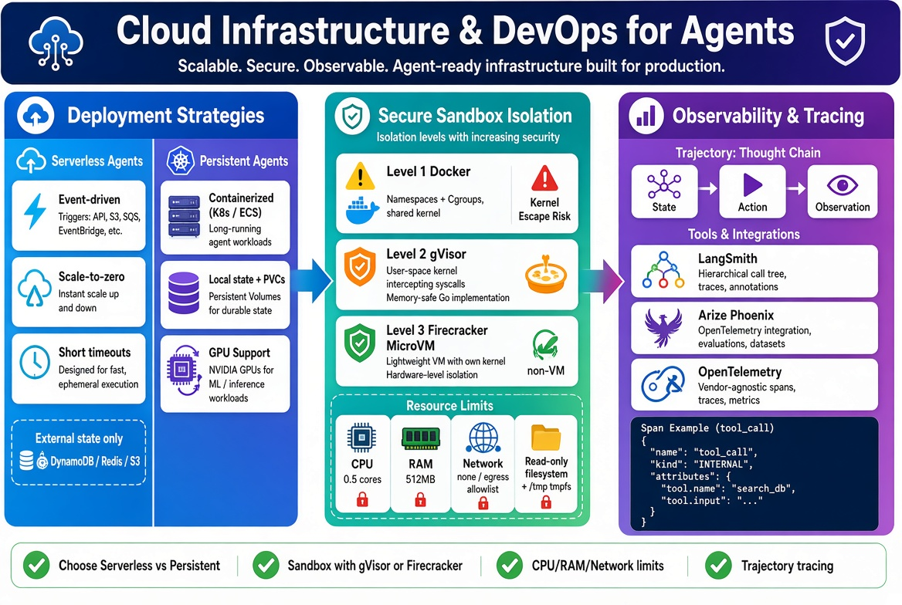

# Cloud Infrastructure & DevOps for Agents

!!! info "Learning Objectives"
    - Evaluate deployment strategies for AI agents, choosing between serverless and persistent containerized architectures.
    - Implement a secure sandbox for autonomous code execution using gVisor, Firecracker, or Docker-based isolation.
    - Configure resource limits to ensure host stability and prevent denial-of-service attacks.
    - Establish observability for agentic trajectories using tracing tools like LangSmith, Arize Phoenix, or OpenTelemetry.

## Overview

As AI agents evolve from simple chat interfaces to autonomous entities capable of executing code and managing long-running workflows, the underlying infrastructure must shift from "hosting a model" to "orchestrating a runtime."

Traditional application infrastructure focuses on request-response cycles. Agentic infrastructure, however, must support non-deterministic execution paths, stateful trajectories, and—most critically—the secure execution of untrusted code generated by the LLM. This chapter explores the architectural patterns required to deploy, isolate, and observe agents in production.



## Deployment Strategies

Choosing a deployment model depends on the agent's duty cycle, required state, and execution duration.

### Serverless Agents

Serverless architectures (e.g., AWS Lambda, Azure Functions) treat agent execution as an event-driven task.

**Why this matters**: AI agent workloads are often sporadic. Serverless allows infrastructure to scale to zero when idle, eliminating the cost of maintaining always-on servers for agents that only trigger on specific events.

**Real-World Scenario**: An email triage agent is triggered by an AWS SNS event whenever a new support email arrives. The agent parses the intent, calls a set of tools, and updates a database—all within a 30-second execution window.

**Technical Considerations**:

- **Scaling**: Automatic horizontal scaling based on event volume.
- **Statelessness**: All state must be externalized to a database (e.g., DynamoDB or Redis).
- **Cold Starts**: Initial latency during the first invocation after inactivity.
- **Timeouts**: Hard limits (e.g., 15 minutes for AWS Lambda) can terminate agents with deep thought chains or slow tool calls.

### Persistent Agents

Persistent agents run in containerized environments (e.g., Kubernetes, ECS) and maintain a continuous runtime.

**Why this matters**: Complex agents often require persistent local state, long-running execution loops (hours or days), or specialized hardware like GPUs that serverless environments cannot provide.

**Real-World Scenario**: An autonomous market researcher spends four hours browsing the web, synthesizing reports, and refining search queries. This requires a persistent filesystem for drafting reports and an execution window that exceeds serverless limits.

**Technical Considerations**:

- **Orchestration**: Kubernetes allows for fine-grained control over pod placement and autoscaling.
- **Statefulness**: Support for Persistent Volume Claims (PVCs) for local caching.
- **Hardware Access**: Direct integration with GPU nodes for local embedding or inference.
- **Overhead**: Requires managing cluster ingress, container registries, and resource quotas.

### Deployment Comparison

| Feature | Serverless | Persistent (Containers) |
| :--- | :--- | :--- |
| **Cost** | Pay-per-execution | Pay-per-provisioned-resource |
| **Scaling** | Instant, automatic | Pod startup latency |
| **Timeout** | Strict (minutes) | Virtually unlimited |
| **State** | External only | Local + External |
| **Hardware** | Standard CPU/RAM | GPU / High-perf storage |

### Example: Kubernetes Deployment Configuration

The following configuration defines a persistent agent with dedicated resource limits to ensure it does not starve other services in the cluster.

```yaml
apiVersion: apps/v1
kind: Deployment
metadata:
  name: research-agent
spec:
  replicas: 2
  selector:
    matchLabels:
      app: research-agent
  template:
    metadata:
      labels:
        app: research-agent
    spec:
      containers:
      - name: agent-container
        image: my-registry/ai-agent:latest
        resources:
          limits:
            cpu: "2"
            memory: "4Gi"
          requests:
            cpu: "1"
            memory: "2Gi"
        env:
        - name: OPENAI_API_KEY
          valueFrom:
            secretKeyRef:
              name: agent-secrets
              key: api-key
```

## The Sandbox Requirement

Autonomous agents frequently use `PythonREPL` or similar tools to execute code. Running LLM-generated code on a host machine creates a critical security vulnerability.

### Security Risks of Code Execution

Allowing an LLM to execute arbitrary code can lead to:

- **Filesystem Destruction**: Deleting critical host files (e.g., `rm -rf /`).
- **Credential Theft**: Accessing environment variables or `.ssh` keys.
- **Network Attacks**: Using the host IP to perform DDoS attacks or scan internal networks.
- **Persistence**: Installing backdoors or rootkits on the host.

### Isolation Levels

To mitigate these risks, agents must execute code in a sandbox—a restricted environment that decouples the execution from the host OS.

#### Level 1: Docker-based Isolation
Docker uses Linux Namespaces and Cgroups to isolate processes.

!!! warning "The Kernel Escape Pitfall"
    Docker containers share the host kernel. A "kernel escape" vulnerability allows an attacker to break out of the container and gain root access to the host. Docker is insufficient for high-risk, untrusted code execution.

#### Level 2: gVisor (Application Kernel)
gVisor implements a user-space kernel that intercepts system calls.

**Why this matters**: By handling system calls in a memory-safe language (Go) instead of passing them directly to the host kernel, gVisor provides a strong security boundary while remaining compatible with OCI runtimes.

#### Level 3: MicroVMs (Firecracker)
Firecracker provides the isolation of a Virtual Machine with the speed of a container.

**Why this matters**: Each sandbox is a lightweight VM with its own minimal kernel, providing hardware-level isolation. This is the technology powering AWS Lambda and Fargate.

### Resource Limiting and Stability

Isolation is not only about security but also about stability. A buggy agent could enter an infinite loop, consuming all host CPU or RAM.

**Key Restrictions**:

- **CPU**: Limit cores (e.g., `cpus: 0.5`) to prevent CPU exhaustion.
- **RAM**: Set hard memory limits (e.g., `memory: 512mb`) to prevent Out-of-Memory (OOM) crashes.
- **Network**: Disable network access or use an egress allowlist to prevent data exfiltration.
- **Disk**: Use a read-only root filesystem with a small, temporary writable `/tmp` directory.

### Example: Restricted Docker Runtime

The following command demonstrates how to run an agent tool with strict resource and network constraints.

```bash
# Run a python agent tool in a restricted container
docker run --rm \
  --memory="512m" \
  --cpus="0.5" \
  --network none \
  --read-only \
  --tmpfs /tmp \
  python:3.11-slim \
  python -c "print('Hello from the sandbox!')"
```

## Observability & Tracing

Agent behavior is non-deterministic. Unlike a standard function call, an agent may take multiple paths, loop, or fail halfway through a complex trajectory.

### Tracking the Thought Chain

A "trajectory" is the sequence of State, Action, and Observation tuples. Visualizing this thought chain is essential for debugging.

**Why this matters**: Trajectory visualization allows developers to identify:

- **Looping**: The agent repeating the same failed action.
- **Hallucinations**: The agent acting on a false assumption.
- **Inefficiency**: The agent taking 20 steps for a 2-step problem.

### Tracing Tools

#### LangSmith
A specialized platform for LLM observability that captures traces of every call. It visualizes the hierarchy of calls (e.g., Agent $\rightarrow$ Tool $\rightarrow$ LLM $\rightarrow$ Tool).

#### Arize Phoenix
An open-source, local-first observability library that integrates with OpenTelemetry for tracing and evaluation.

#### OpenTelemetry (OTel)
The industry standard for distributed tracing. By wrapping agent tool calls in OTel **Spans**, trajectories can be exported to any compatible backend (e.g., Jaeger).

### Example: Instrumenting Agent Tools with OpenTelemetry

The following Python snippet demonstrates how to wrap a tool execution in an OTel span to track the trajectory.

```python
from opentelemetry import trace

# Initialize the tracer for agent infrastructure
tracer = trace.get_tracer("agent.infrastructure")

def execute_agent_tool(tool_name, args):
    # Create a span to track this specific tool execution
    with tracer.start_as_current_span(f"tool_call:{tool_name}") as span:
        span.set_attribute("tool.args", str(args))
        try:
            # The tool_registry contains the actual tool implementations
            result = tool_registry[tool_name](args)
            span.set_attribute("tool.status", "success")
            return result
        except Exception as e:
            # Record the exception in the trace for debugging
            span.record_exception(e)
            span.set_status(trace.Status(trace.StatusCode.ERROR))
            raise e
```

## Summary Checklist

!!! tip "Summary Checklist"
    - [ ] Identified the correct deployment strategy (Serverless vs. Persistent) based on duty cycle and state requirements.
    - [ ] Implemented a sandbox (gVisor or Firecracker) to isolate LLM-generated code from the host OS.
    - [ ] Configured CPU, RAM, and Network egress limits for all agent runtimes.
    - [ ] Integrated a tracing tool (LangSmith, Phoenix, or OTel) to visualize agent trajectories.
    - [ ] Verified that agent state is externalized in serverless deployments.

## Assignments

!!! note "Exercise 1: Deployment Analysis"
    Analyze a scenario where an agent must monitor a stock portfolio in real-time and send alerts. Decide between serverless and persistent deployment. Justify your choice based on cost, state, and timeout constraints.
    
    ??? question "Solution"
        A persistent deployment (Containers/K8s) is preferred here. Real-time monitoring requires a long-running process to maintain a connection to a data stream (e.g., WebSocket). A serverless function would either timeout or incur massive costs due to frequent polling and cold starts.

!!! note "Exercise 2: Sandbox Hardening"
    Write a Docker run command that executes a Python script with the following constraints: 256MB RAM, 0.25 CPU cores, no network access, and a read-only filesystem.
    
    ??? question "Solution"
        ```bash
        docker run --rm --memory="256m" --cpus="0.25" --network none --read-only python:3.11-slim python -c "print('Secure')"
        ```

!!! note "Exercise 3: Tracing Implementation"
    Design an OpenTelemetry span structure for an agent that uses a "Plan-and-Execute" loop. Which attributes should be added to the spans to make the trajectory easy to debug?
    
    ??? question "Solution"
        The structure should include a root span for the overall task and child spans for each "Plan" and "Execute" step.
        Key attributes to include:
        - `agent.plan_id`: To group all steps of a single plan.
        - `step.index`: The sequence number of the current action.
        - `llm.prompt`: The prompt used to generate the plan.
        - `tool.output`: The observation returned by the tool.

## References

- AWS Firecracker Documentation: https://firecracker-microvm.github.io/
- gVisor Documentation: https://gvisor.dev/docs/
- LangSmith Documentation: https://docs.smith.langchain.com/
- OpenTelemetry Specification: https://opentelemetry.io/docs/specs/otel/

## Self-Evaluation

??? note "What is the primary security risk of allowing an agent to use a PythonREPL tool?"
    The primary risk is Remote Code Execution (RCE). An LLM could be manipulated via prompt injection to execute malicious commands on the host system, such as deleting files or stealing API keys.

??? note "When would you choose a persistent container over a serverless function for agent deployment?"
    When the agent requires long-running execution loops (exceeding serverless timeouts), needs persistent local state (files), or requires specialized hardware like GPUs.

??? note "How does gVisor differ from a standard Docker container in terms of security?"
    Standard Docker shares the host kernel. gVisor implements a user-space application kernel that intercepts system calls, preventing the application from interacting directly with the host kernel.

??? note "What is a 'trajectory' in the context of agent observability?"
    A trajectory is the sequence of states, actions, and observations that an agent goes through to solve a task. It represents the agent's "thought chain" over time.

??? note "Why is network egress filtering critical for agent sandboxes?"
    Without egress filtering, a compromised agent could exfiltrate sensitive data from the environment to an external server or attack other internal services within the same VPC.
