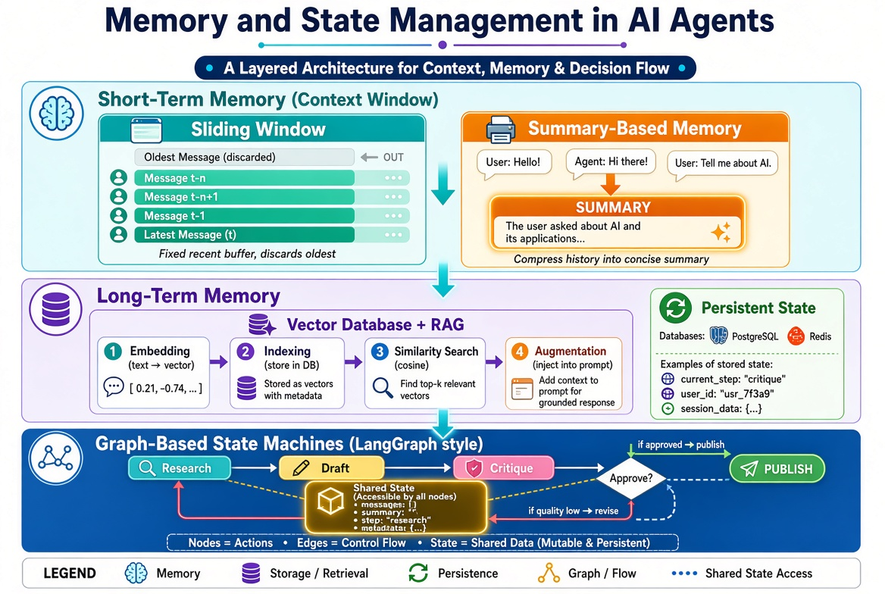

# Memory and State Management

!!! info "Learning Objectives"
    By the end of this chapter, you will be able to:
    - Implement and compare sliding window and summary-based short-term memory strategies.
    - Architect a long-term memory system using Vector Databases and Retrieval Augmented Generation (RAG).
    - Design persistent agent states to maintain continuity across user sessions.
    - Model complex agent workflows using graph-based state machines.

## Overview

In a standard LLM interaction, the model is stateless; it treats every request as an isolated event. To create "agents" that can conduct long-running tasks, remember user preferences, and follow complex multi-step workflows, we must implement a memory layer. This chapter explores the hierarchy of AI memory—from the fleeting context window to permanent vector storage—and the structural state machines that govern agent behavior.



## Short-Term Memory

Short-term memory in agentic AI is the management of the "context window"—the limited amount of text a model can consider at any one time.

### Context Window Management

Why this matters: Every LLM has a hard token limit. If a conversation exceeds this limit, the model will either truncate the oldest messages or fail entirely. Managing this window is the difference between an agent that remembers the user's goal and one that becomes confused mid-conversation.

#### Sliding Windows

The sliding window approach maintains a fixed-size buffer of the most recent interactions. As new tokens are added, the oldest tokens are discarded.

:::tip "When to use"
Use sliding windows for low-complexity tasks where only the immediate history is relevant, such as simple Q&A bots.
:::

#### Summary-Based Memory

Instead of discarding old data, summary-based memory uses a second LLM process to compress historical context into a concise summary, which is then injected into the current prompt.

:::warning "The Granularity Trade-off"
Summarization preserves the "gist" of the conversation but destroys specific details (e.g., a specific order number mentioned 20 messages ago). Always combine summarization with a mechanism to preserve "critical facts."
:::

### Real-World Scenario: Technical Troubleshooting Bot

Imagine a bot assisting a user with a network outage.

- **Sliding Window Failure**: The user mentions they have a "Cisco ISR 4000" in the first message. By message 50, that detail has slid out of the window. The agent then asks, "Which router model are you using?"—frustrating the user.
- **Summary-Based Success**: The agent maintains a summary: "User is troubleshooting a Cisco ISR 4000 with intermittent WAN drops." This summary remains at the top of the context window regardless of conversation length.

### Implementation: Memory Strategies in Python

```python
from typing import List, Dict

class AgentMemory:
    def __init__(self, window_size: int = 5):
        self.window_size = window_size
        self.history: List[Dict[str, str]] = []
        self.summary = ""

    def add_message(self, role: str, content: str):
        """Adds a message and manages the window."""
        self.history.append({"role": role, "content": content})
        
        # Simple Sliding Window implementation
        if len(self.history) > self.window_size:
            # In a real system, we would trigger a summarization 
            # before popping the oldest message
            self.history.pop(0)

    def summarize_history(self, llm_client):
        """
        Simulates a summarization call to condense history.
        In production, this would be a prompt like: 
        'Summarize the following conversation while keeping key entities.'
        """
        full_text = " ".join([m["content"] for m in self.history])
        # Mock LLM call
        self.summary = f"Summary: The user is discussing {full_text[:50]}..."
        print(f"History summarized: {self.summary}")

    def get_prompt_context(self) -> str:
        """Combines summary and recent history for the LLM."""
        recent_history = "\n".join([f"{m['role']}: {m['content']}" for m in self.history])
        return f"System Summary: {self.summary}\n\nRecent History:\n{recent_history}"

# Usage
memory = AgentMemory(window_size=3)
memory.add_message("user", "I am using a Cisco ISR 4000.")
memory.add_message("assistant", "Got it. What is the error code?")
memory.add_message("user", "It is ERR_001.")
memory.add_message("assistant", "Checking the manual...")
memory.add_message("user", "I also noticed the power LED is red.")

# Simulate a summarization step
# memory.summarize_history(mock_llm) 
print(memory.get_prompt_context())
```

## Long-Term Memory

Long-term memory allows agents to maintain knowledge and state across different sessions, days, or even months.

### Vector Databases and RAG

Why this matters: It is impossible to fit a company's entire knowledge base or a user's entire life history into a context window. Retrieval Augmented Generation (RAG) solves this by treating a database as an "external hard drive."

The RAG process follows a specific pipeline:

1. **Embedding**: Convert text into high-dimensional vectors.
2. **Indexing**: Store vectors in a specialized database (e.g., Pinecone, Milvus, Weaviate).
3. **Querying**: Convert the user's query into a vector and perform a similarity search (Cosine Similarity) to find the closest matches.
4. **Augmentation**: Inject the retrieved "chunks" into the prompt.

### Persistent State Management

While RAG is for unstructured knowledge, persistent state is for structured "agent variables." This involves saving the agent's internal state (e.g., `current_step: "validation"`, `user_id: "123"`) into a database like PostgreSQL or Redis.

:::tip "State vs. Memory"
- **Memory (RAG)**: "I remember you mentioned you liked Python last month."
- **State (Persistent)**: "I know you are currently on Step 3 of the 5-step onboarding process."
:::

### Real-World Scenario: Personalized Learning Agent

An AI tutor for data science:

- **RAG usage**: The agent retrieves the student's past mistakes from a "Mistake Log" vector DB to create a tailored review session.
- **State usage**: The agent knows the student has completed "Linear Algebra 101" but has not yet started "Multivariable Calculus," ensuring the agent doesn't skip ahead.

### Implementation: Conceptual RAG Flow

```python
import numpy as np
from sklearn.metrics.pairwise import cosine_similarity

class LongTermMemory:
    def __init__(self):
        # Mock Vector DB: {text: vector}
        self.vector_store = {
            "User prefers Python over Java": np.array([0.1, 0.9, 0.2]),
            "User is a Senior Architect": np.array([0.8, 0.1, 0.3]),
            "Project deadline is Dec 1st": np.array([0.2, 0.3, 0.9]),
        }

    def _mock_embed(self, text: str):
        """Simulates text embedding."""
        # In reality, use OpenAI text-embedding-3-small or similar
        return np.random.rand(3)

    def retrieve(self, query: str, k=1):
        """Finds the most similar memory."""
        query_vec = self._mock_embed(query)
        
        similarities = {}
        for text, vec in self.vector_store.items():
            sim = cosine_similarity([query_vec], [vec])[0][0]
            similarities[text] = sim
            
        # Sort by similarity descending
        sorted_memories = sorted(similarities.items(), key=lambda x: x[1], reverse=True)
        return sorted_memories[:k]

# Usage
ltm = LongTermMemory()
query = "What language should I use for the project?"
result = ltm.retrieve(query)
print(f"Retrieved Memory: {result[0][0]} (Score: {result[0][1]:.2f})")
```

## State Machines and Agent Flow

Why this matters: A simple loop of "Plan -> Act -> Observe" often leads to "agent loops" where the AI repeats the same mistake. State machines provide the guardrails necessary for production-grade reliability.

### Graph-Based Flow

Modern agent frameworks (like LangGraph) treat the agent as a graph.

- **Nodes**: Discrete functions that perform a task (e.g., `fetch_data`, `write_report`).
- **Edges**: The paths between nodes.
- **Conditional Edges**: Logic that determines the next node based on the output of the previous one (e.g., "If report quality < 80%, go back to `fetch_data`").
- **Shared State**: A single object that travels through the graph, updated by each node.

### Real-World Scenario: Automated Content Pipeline

1. **Node: Research**: Scrapes the web for a topic.
2. **Node: Draft**: Writes a first draft based on research.
3. **Node: Critique**: An "LLM Judge" reviews the draft.
4. **Conditional Edge**:
    - If "Needs Revision" $\rightarrow$ Route back to **Draft**.
    - If "Approved" $\rightarrow$ Route to **Publish**.

### Implementation: State Machine Logic

```python
from typing import TypedDict, List, Optional

class GraphState(TypedDict):
    topic: str
    research_notes: List[str]
    draft: Optional[str]
    is_approved: bool

def research_node(state: GraphState):
    print("--- Researching Topic ---")
    # Simulate scraping
    return {"research_notes": ["AI Memory is complex", "RAG is essential"]}

def draft_node(state: GraphState):
    print("--- Drafting Content ---")
    # Simulate writing
    return {"draft": f"AI Memory is complex. {state['research_notes'][1]}"}

def review_node(state: GraphState):
    print("--- Reviewing Draft ---")
    # Logic: approve if draft is long enough
    approved = len(state["draft"]) > 20
    return {"is_approved": approved}

# Simple Graph Orchestrator
def run_agent(topic: str):
    state: GraphState = {"topic": topic, "research_notes": [], "draft": None, "is_approved": False}
    
    # Execute Graph
    state.update(research_node(state))
    state.update(draft_node(state))
    
    while not state["is_approved"]:
        state.update(review_node(state))
        if not state["is_approved"]:
            print("Review failed. Redrafting...")
            state.update(draft_node(state))
            
    return state["draft"]

# Usage
final_report = run_agent("Agentic Memory")
print(f"Final Report: {final_report}")
```

## Summary Checklist

- [ ] Understand the token limit constraints of the context window.
- [ ] Differentiate between sliding window and summary-based memory.
- [ ] Implement a basic RAG pipeline using embeddings and vector similarity.
- [ ] Distinguish between unstructured memory (RAG) and structured state (Persistent State).
- [ ] Model an agent workflow as a graph with nodes and conditional edges.

## Assignments

!!! note "Implementation: The Smart History Bot"
    Create a Python class that implements both a sliding window (last 5 messages) and a summarization trigger. When the window exceeds 5, the bot should "summarize" the oldest 2 messages into a single string and prepend it to the history.
    
    ??? question "Solution"
        ```python
        class SmartHistory:
            def __init__(self):
                self.history = []
                self.summary = ""
            
            def add(self, msg):
                self.history.append(msg)
                if len(self.history) > 5:
                    # Summarize oldest 2
                    to_sum = self.history[:2]
                    self.summary += f" (Previously: {to_sum[0]}, {to_sum[1]})"
                    self.history = self.history[2:]
        ```

!!! note "Architecture: User Preference Engine"
    Design a system architecture where an agent remembers a user's favorite programming language across sessions. Which components would you use? (e.g., Database, Embedding Model, etc.)
    
    ??? question "Solution"
        1. **Storage**: A Vector Database (e.g., Pinecone) to store user preference embeddings.
        2. **Processing**: An embedding model to vectorize the user's stated preferences.
        3. **Retrieval**: A RAG step at the start of every session to pull "User Preferences" based on the user's ID.
        4. **Context**: Inject the retrieved preference into the system prompt: "The user prefers Python."

## References

- LangChain Memory Documentation: https://python.langchain.com/docs/modules/memory/
- LangGraph Conceptual Guide: https://langchain-ai.github.io/langgraph/
- Pinecone Vector Database Guide: https://docs.pinecone.io/

## Self-Evaluation

??? note "What is the primary limitation of a sliding window memory strategy?"
    It completely loses early context. Once a message slides out of the window, the agent has no way to retrieve it, which can lead to repetitive questioning or loss of the original goal.

??? note "How does summary-based memory differ from RAG?"
    Summary-based memory is a form of short-term context management (compressing current conversation), whereas RAG is a long-term memory strategy (retrieving specific facts from a large external database).

??? note "Why is a shared state object used in graph-based agent flows?"
    A shared state allows different nodes (functions) to contribute to and read from a single source of truth, enabling complex dependencies (e.g., the `review_node` needs the `draft` created by the `draft_node`).

??? note "What is the difference between an edge and a conditional edge in LangGraph?"
    A standard edge always moves from Node A to Node B. A conditional edge uses a function (often an LLM) to decide which node to transition to next based on the current state.

??? note "When would you use a relational database instead of a vector database for agent memory?"
    Use a relational database (SQL) for structured, deterministic state (e.g., user account settings, step-by-step progress tracking). Use a vector database for unstructured, semantic retrieval (e.g., searching through thousands of past chat logs).
