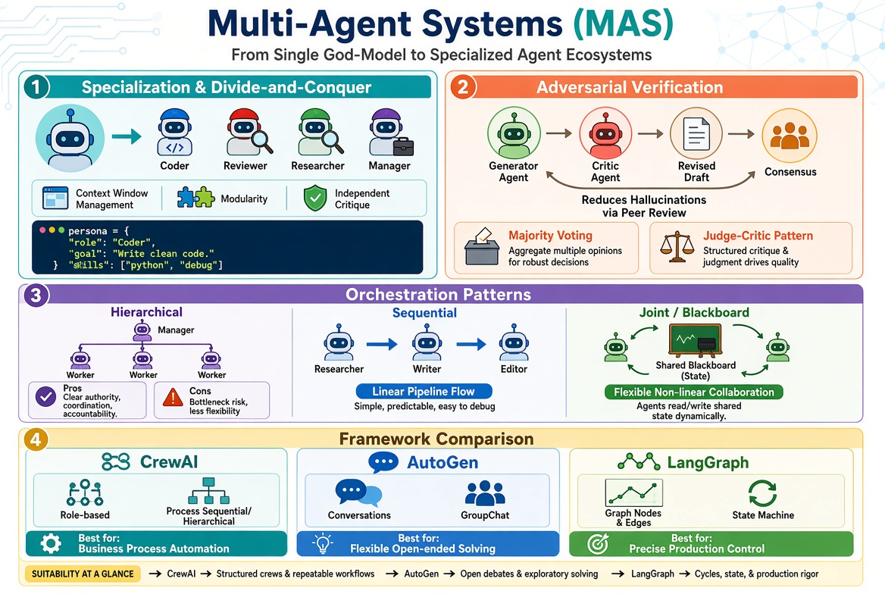

# Multi-Agent Systems (MAS)

!!! info "Learning Objectives"

    After completing this chapter, you will be able to:

    * Explain the architectural advantages of multi-agent systems over single-agent designs.
    * Implement adversarial and consensus mechanisms to reduce LLM hallucinations.
    * Design and differentiate between hierarchical, sequential, and joint orchestration patterns.
    * Select the appropriate framework (CrewAI, AutoGen, or LangGraph) based on the requirements of a specific use case.
    * Build a basic multi-agent workflow using a modern MAS framework.

## Overview

The evolution of agentic AI has shifted from building a single, all-purpose "god-model" to designing ecosystems of specialized agents. While a single large language model (LLM) is capable of many tasks, it often struggles when a project requires conflicting personas—such as the creativity needed to write code and the pedantry needed to review it.

Multi-Agent Systems (MAS) solve this by decomposing a complex goal into smaller, manageable roles. By assigning specific personas, tools, and constraints to different agents, developers can create a system of checks and balances that mimics a professional human organization. This approach not only improves the quality of the output but also makes the system more modular, easier to debug, and more resilient to hallucinations.



## The Case for Multi-Agent Architectures

### Specialization and the Divide-and-Conquer Pattern

The core premise of MAS is specialization. Instead of one prompt attempting to handle every nuance of a project, the workload is distributed across agents with distinct roles.

Consider a software development team. A single person rarely handles requirements gathering, system architecture, coding, unit testing, and DevOps deployment simultaneously. Instead, these roles are split among a Product Manager, an Architect, a Developer, and a QA Engineer. Each role requires a different mindset: the Architect focuses on sustainability, while the Developer focuses on implementation.

In an AI context, this is achieved through prompt specialization. A "Coder" agent is prompted to be functional and creative, while a "Reviewer" agent is prompted to be critical and suspicious.

**Why this matters**: Forcing a single LLM to act as both the creator and the critic in a single turn often leads to "confirmation bias," where the model overlooks its own errors. Specialization ensures that the critique is independent of the creation.

Technical benefits include:

* **Context Window Management**: Agents only receive the information relevant to their role, reducing noise.
* **Modularity**: You can replace a general-purpose model with a specialized one (e.g., using a coding-specific model for the Coder agent) without altering the rest of the system.

```python
# Example: Defining specialized personas in a conceptual MAS
agents = {
    "coder": {
        "role": "Senior Python Developer",
        "goal": "Write clean, efficient, and documented Python code",
        "persona": "You are a pragmatic developer who prioritizes readability and performance."
    },
    "reviewer": {
        "role": "Security Auditor",
        "goal": "Find vulnerabilities and logic flaws in code",
        "persona": "You are a pedantic auditor who assumes every line of code has a bug."
    }
}
```

### Improving Reliability via Adversarial Verification

LLMs are probabilistic, which makes them prone to hallucinations. MAS reduces this risk by introducing adversarial agents and consensus mechanisms.

#### The Adversarial Debate Pattern

In this pattern, two or more agents are tasked with challenging each other. Agent A proposes a solution, and Agent B (the Adversary) is specifically prompted to find flaws or edge cases in that solution. Agent A then revises the proposal based on the critique.

This iterative loop pushes the output toward a more grounded truth by simulating a peer-review process.

#### Consensus Mechanisms

Consensus mechanisms are used when factual accuracy is paramount.

1. **Majority Voting**: Multiple independent agents generate an answer to the same question. The system selects the answer that appears most frequently.
2. **Judge-Critic Pattern**: Several worker agents provide different drafts of a solution. A high-reasoning "Judge" agent evaluates these drafts against a rubric and merges the best elements into a final response.

**Why this matters**: By introducing checks and balances, the system moves from "hoping the model is correct" to "verifying the result through multiple perspectives."

```python
# Conceptual implementation of a Self-Correction Cycle (Generator -> Critic)
def agent_loop(goal):
    draft = generator_agent.generate(goal)
    for i in range(3):  # Limit iterations to prevent infinite loops
        critique = critic_agent.review(draft)
        if "Correct" in critique:
            break
        draft = generator_agent.revise(draft, critique)
    return draft
```

## Multi-Agent Orchestration Patterns

Orchestration defines how agents communicate and how the flow of work is managed.

### Hierarchical Orchestration

In a hierarchical system, a "Manager" agent acts as the central orchestrator. The Manager receives the high-level goal, decomposes it into sub-tasks, assigns these tasks to specialized worker agents, and reviews the final output.

**Real-world Scenario**: An AI Marketing Agency.
* **Manager**: Project Lead (decomposes the campaign goal).
* **Worker 1**: Market Researcher (finds trends).
* **Worker 2**: Copywriter (writes ads).
* **Worker 3**: Graphic Designer (creates visual prompts).

**Pros**: High control, structured output, and easy to trace.
**Cons**: The Manager becomes a single point of failure; if the decomposition is flawed, all workers will fail.

### Sequential Orchestration

Sequential orchestration is a linear pipeline where the output of one agent becomes the input for the next.

**Real-world Scenario**: A Technical Content Pipeline.
1. **Researcher**: Extracts 5 key facts from a whitepaper.
2. **Writer**: Converts those facts into a blog post.
3. **Editor**: Polishes the tone and checks for grammar.

**Pros**: Simple to implement and highly predictable.
**Cons**: Lacks a feedback loop. Errors made in the first stage propagate through the entire pipeline.

### Joint Collaboration

Joint collaboration uses a shared workspace, often called a "Blackboard." All agents have access to a shared state object. Agents observe the state and "volunteer" to act when they see a task that matches their expertise.

**Real-world Scenario**: Collaborative Software Patching.
* The "Architect" updates the implementation plan on the blackboard.
* The "Coder" sees the updated plan and writes the patch.
* The "Tester" sees the patch and writes a failing test case.
* The "Coder" sees the failing test and fixes the patch.

**Pros**: Extremely flexible and supports complex, non-linear workflows.
**Cons**: High complexity in state management and a risk of "infinite loops" where agents continuously correct each other.

## Comparative Analysis of MAS Frameworks

### CrewAI: Role-Based Process Automation

CrewAI focuses on "Crews" composed of agents with defined roles, goals, and backstories. It is designed for structured business processes.

**Key Concepts**:
* **Agent**: A persona with a specific goal and backstory.
* **Task**: A discrete assignment with a description and expected output.
* **Process**: The orchestration strategy (Sequential or Hierarchical).

```python
from crewai import Agent, Task, Crew, Process

# Define Agents
researcher = Agent(
    role='Senior Research Analyst',
    goal='Identify emerging trends in AI Agents',
    backstory='You are an expert at identifying trends in technology.',
    verbose=True
)

writer = Agent(
    role='Tech Content Strategist',
    goal='Craft compelling articles on AI Agents',
    backstory='You transform complex research into easy-to-read guides.',
    verbose=True
)

# Define Tasks
task1 = Task(description='Analyze trends in MAS for 2025.', agent=researcher, expected_output='A bulleted list of 5 trends.')
task2 = Task(description='Write a blog post based on the research.', agent=writer, expected_output='A 500-word blog post.')

# Instantiate Crew
crew = Crew(
    agents=[researcher, writer],
    tasks=[task1, task2],
    process=Process.sequential
)

result = crew.kickoff()
```

### AutoGen: Conversation-Driven Agency

Developed by Microsoft, AutoGen treats multi-agent interaction as a conversation. It is highly flexible and excels in open-ended problem solving.

**Key Concepts**:
* **ConversableAgent**: Agents that can send and receive messages.
* **GroupChatManager**: Manages the turn-taking logic in a group of agents.
* **UserProxyAgent**: A proxy that allows a human to intervene or provide feedback.

```python
import autogen

config_list = [{"model": "gpt-4", "api_key": "YOUR_API_KEY"}]

assistant = autogen.AssistantAgent(
    name="Assistant",
    llm_config={"config_list": config_list}
)

user_proxy = autogen.UserProxyAgent(
    name="User",
    human_input_mode="NEVER",
    max_consecutive_auto_reply=2,
    code_execution_config={"work_dir": "coding", "use_docker": False}
)

user_proxy.initiate_chat(
    assistant,
    message="Write a python script to fetch the current price of Bitcoin."
)
```

### LangGraph: Precise State Machine Control

LangGraph, by LangChain, treats MAS as a graph-based state machine. It is built for production environments where precise control over cycles and conditional logic is required.

**Key Concepts**:
* **Nodes**: Python functions that modify the shared state.
* **Edges**: Define the path between nodes, including conditional edges.
* **State**: A shared object passed between all nodes in the graph.

```python
from typing import TypedDict
from langgraph.graph import StateGraph, END

class AgentState(TypedDict):
    content: str
    critique: str
    iterations: int

def generator(state: AgentState):
    # Simplified generator logic
    return {"content": "The capital of France is Lyon.", "iterations": state["iterations"] + 1}

def critic(state: AgentState):
    # Simplified critic logic
    if "Paris" in state["content"]:
        return {"critique": "Correct"}
    return {"critique": "Wrong, the capital is Paris."}

def should_continue(state: AgentState):
    if state["critique"] == "Correct" or state["iterations"] >= 3:
        return END
    return "generator"

workflow = StateGraph(AgentState)
workflow.add_node("generator", generator)
workflow.add_node("critic", critic)

workflow.set_entry_point("generator")
workflow.add_edge("generator", "critic")
workflow.add_conditional_edges("critic", should_continue)

app = workflow.compile()
app.invoke({"content": "", "critique": "", "iterations": 0})
```

## Summary Checklist

!!! tip "Summary Checklist"

* [ ] Understood the "Divide and Conquer" principle of agent specialization.
* [ ] Identified how adversarial agents and consensus mechanisms reduce hallucinations.
* [ ] Distinguished between Hierarchical, Sequential, and Joint orchestration patterns.
* [ ] Evaluated the trade-offs between CrewAI, AutoGen, and LangGraph.
* [ ] Implemented a basic multi-agent loop with a generator and a critic.

## Assignments

!!! note "Exercise 1: The Editorial Loop"

Create a sequential workflow using any framework of your choice. The workflow should consist of three agents: a Researcher, a Writer, and an Editor. The Editor must have a persona that is specifically prompted to be critical of the Writer's tone.

    ??? question "Solution"
        The solution should define three distinct agents. The Researcher's output (facts) should feed into the Writer, and the Writer's output (draft) should feed into the Editor. The Editor's system prompt should include instructions like "You are a strict editor who dislikes fluff and corporate jargon."

!!! note "Exercise 2: Implementing a Debate"

Implement a simple "Debate" pattern where two agents argue for and against a specific technical choice (e.g., "SQL vs NoSQL for a real-time chat app"). A third "Judge" agent must summarize the arguments and make a final decision.

    ??? question "Solution"
        This requires a GroupChat (AutoGen) or a Graph with a conditional loop (LangGraph). The Judge agent should only be invoked after both the Pro-SQL and Pro-NoSQL agents have spoken at least once.

!!! note "Exercise 3: State-Based Collaboration"

Build a LangGraph workflow where a "Coder" and a "Tester" share a state object containing a `code` field and a `test_results` field. The Coder should only run if `test_results` is "Failed".

    ??? question "Solution"
        Define a `State` TypedDict with `code` and `test_results`. Create a conditional edge from the Tester node: if `state['test_results'] == 'Passed'`, go to `END`; otherwise, go back to the Coder node.

## References

* CrewAI Documentation: https://docs.crewai.com
* AutoGen Documentation: https://microsoft.github.io/autogen/
* LangGraph Documentation: https://langchain-ai.github.io/langgraph/

## Self-Evaluation

??? note "What is the primary reason for using specialized agents instead of one large model?"
    Specialization allows for conflicting personas (e.g., creator vs. critic), reduces noise in the context window, and allows the use of model-specific strengths for different tasks.

??? note "How does the Adversarial Debate pattern reduce hallucinations?"
    By forcing a proposal to be critiqued by an independent agent, the system identifies inaccuracies and edge cases that the original generator would have overlooked.

??? note "Compare Hierarchical and Sequential orchestration in terms of error propagation."
    In sequential orchestration, errors in early stages propagate linearly to the end. In hierarchical orchestration, the Manager can catch errors at the worker level and request revisions before aggregating the final result.

??? note "Which framework is most suitable for a production system requiring strict state machine logic and cycles?"
    LangGraph is most suitable because it explicitly models workflows as graphs with nodes and edges, providing fine-grained control over state and loops.

??? note "What is a 'Blackboard' in the context of joint collaboration?"
    A Blackboard is a shared state object that all agents can read from and write to, allowing them to coordinate their actions based on the current progress of the task.
