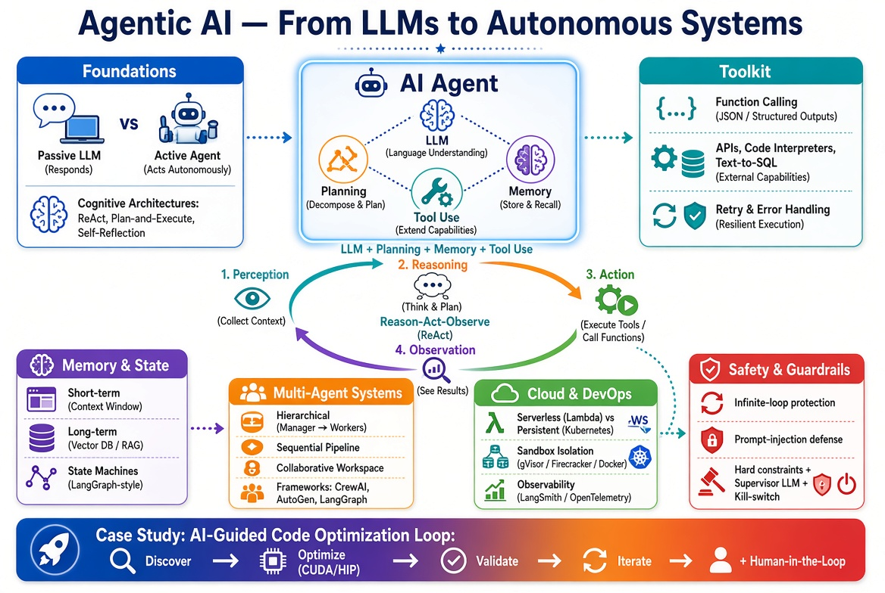

# Chapter: Agentic AI - From LLMs to Autonomous Systems

This chapter explores the transition from passive Large Language Models (LLMs) to **Agentic AI**—systems capable of reasoning, using tools, and executing iterative loops to achieve complex goals. Given the course focus on Cloud Computing and DevOps, this chapter emphasizes the infrastructure, deployment, and operational guardrails required to run autonomous agents safely and scalably.

!!! info "Learning Objectives"

    By the end of this chapter, students will be able to:

    - Distinguish between a standard LLM prompt and an agentic workflow.
    - Implement a basic "Reason-Act-Observe" (ReAct) loop.
    - Design and integrate external tools (APIs, shell scripts) into an AI agent.
    - Understand the trade-offs between single-agent and multi-agent architectures.
    - Deploy an agentic system within a cloud-native environment with proper sandboxing.
    - Build a self-improving loop for a specific domain (e.g., AI-guided code optimization).

---

## [1. Foundations of Agentic AI](foundations-chapter.md)
- [x] **What is an AI Agent?**
    - [x] Definition: LLM + Planning + Memory + Tool Use.
    - [x] The Agentic Loop: Perception $\rightarrow$ Reasoning $\rightarrow$ Action $\rightarrow$ Observation.
    - [x] Passive vs. Active AI: Chatbots vs. Agents.
- [x] **Cognitive Architectures**
    - [x] **ReAct (Reason + Act):** The core pattern of interleaving thought and action.
    - [x] **Plan-and-Execute:** Decomposing complex goals into sub-tasks before execution.
    - [x] **Self-Reflection:** Agents that critique and correct their own outputs.

## [2. The Agent's Toolkit: Tool Use & Function Calling](toolkit-chapter.md)
- [x] **The Mechanics of Tool Use**
    - [x] Function Calling: How LLMs generate structured arguments (JSON).
    - [x] Tool Definition: Writing clear descriptions to guide the model.
- [x] **Integration Patterns**
    - [x] API Integration: Connecting agents to cloud services.
    - [x] Code Interpreters: Allowing agents to write and run Python/Bash in real-time.
    - [x] Database Interaction: Text-to-SQL and autonomous data retrieval.
- [x] **Reliability & Error Handling**
    - [x] Handling tool failures and hallucinated arguments.
    - [x] Implementing "retry" logic within the agent loop.

## [3. Memory and State Management](memory-chapter.md)
- [x] **Short-Term Memory**
    - [x] Context window management and sliding windows.
    - [x] Summary-based memory for long conversations.
- [x] **Long-Term Memory**
    - [x] Vector Databases & RAG (Retrieval Augmented Generation).
    - [x] Persistent state: Saving agent progress across sessions.
- [x] **State Machines**
    - [x] Using graphs to define agent flow (e.g., LangGraph approach).

## [4. Multi-Agent Systems (MAS)](multi-agent-chapter.md)
- [x] **Why Multi-Agent?**
    - [x] Specialization: Divide and conquer (e.g., Coder agent vs. Reviewer agent).
    - [x] Reducing Hallucinations: Adversarial agents and consensus mechanisms.
- [x] **Orchestration Patterns**
    - [x] **Hierarchical:** A "Manager" agent delegating to "Worker" agents.
    - [x] **Sequential:** A pipeline of agents where output $N$ is input $N+1$.
    - [x] **Joint Collaboration:** Agents communicating in a shared workspace.
- [x] **Frameworks Overview**
    - [x] CrewAI, AutoGen, and LangGraph.

## [5. Cloud Infrastructure & DevOps for Agents](infrastructure-chapter.md)
- [x] **Deployment Strategies**
    - [x] Serverless Agents: Using AWS Lambda/Azure Functions for event-driven agents.
    - [x] Persistent Agents: Containerized agents (Kubernetes) for long-running tasks.
- [x] **The Sandbox Requirement (Critical)**
    - [x] Security risks of autonomous code execution.
    - [x] Implementing gVisor, Firecracker, or Docker-based isolation.
    - [x] Resource limiting (CPU/RAM/Network) for agent-spawned processes.
- [x] **Observability & Tracing**
    - [x] Tracking the "Thought Chain": Visualizing agent trajectories.
    - [x] Tools: LangSmith, Arize Phoenix, or custom OpenTelemetry spans.

## [6. Case Study: AI-Guided Code Optimization](case-study-chapter.md)
- [x] **Designing the Loop**
    - [x] Discovery: Identifying compute kernels in scientific code.
    - [x] Optimization: Proposing GPU-friendly rewrites (HIP/CUDA).
    - [x] Validation: Automated benchmark generation and execution.
- [x] **The Iteration Cycle**
    - [x] Analyzing performance metrics $\rightarrow$ Updating prompt $\rightarrow$ Refining code.
- [x] **Human-in-the-Loop (HITL)**
    - [x] Strategic checkpoints for human approval of critical changes.

## [7. Ethics, Safety, and Guardrails](ethics-chapter.md)
- [x] **Agentic Risks**
    - [x] Infinite loops and resource exhaustion ("The recursive loop of death").
    - [x] Prompt injection via tool outputs (Indirect Prompt Injection).
- [x] **Control Mechanisms**
    - [x] Hard constraints: Pre-defined allowed-tool lists.
    - [x] Soft constraints: LLM-based monitors ("The Supervisor").
    - [x] Kill-switches and timeout policies.

---

## Resources & Dependencies
- **Required Reading**: 
    - [ ] [*ReAct: Synergizing Reasoning and Acting in Language Models* (Yao et al.)](https://arxiv.org/abs/2210.03629)
- **Tooling**: 
    - [ ] [Python 3.10+](https://www.python.org/)
    - [ ] APIs
        - [ ] [OpenAI API](https://platform.openai.com/)
        - [ ] [Anthropic API](https://console.anthropic.com/)
        - [ ] [Local LLMs (Ollama)](https://ollama.com/)
    - [ ] Vector DB 
        - [ ] [ChromaDB](https://www.trychroma.com/)
        - [ ] [Pinecone](https://www.pinecone.io/)
    - [ ] [Docker](https://www.docker.com/) for sandboxing
- **Related Course Modules**: 
    - [[02-cloud]] (Cloud Infrastructure)
    - [[oct-devops]] (CI/CD pipelines for agent deployment)
