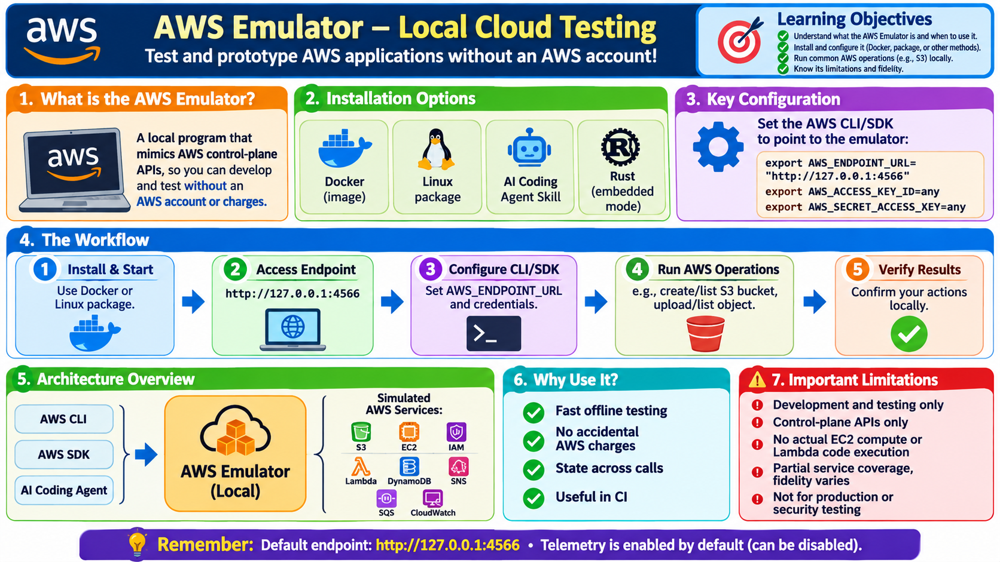

# AWS Emulator – Student Chapter

!!! warning

    This is a draft

!!! info "Learning Objectives"

    * Understand what the AWS Emulator is and when to use it.
    * Install the emulator using one of the supported methods (Linux package, Docker, AI‑coding‑agent skill, or embedded mode).
    * Configure the AWS CLI and SDKs to point to the emulator.
    * Run common AWS service operations (e.g., S3 bucket creation) against the emulator.
    * Recognize the emulator's limitations and how to interpret fidelity scores.

---

## Overview

The **AWS Emulator** is a local program that mimics the control‑plane AWS APIs. It enables you to test and prototype your code **without an AWS account** and without incurring any charges. The emulator runs on your workstation, a development server, or inside a CI pipeline, and works with the **AWS CLI**, **AWS SDKs**, and **AI coding agents**.

Key benefits include:

* **Fast, offline testing** – no network latency to real AWS endpoints.
* **Safety** – you cannot accidentally create billable resources.
* **Fidelity** – the emulator rejects invalid calls with the same errors as the real service and maintains state across calls.
* **Integration** – works with Docker, Linux packages, and an **embedded mode** for Rust tests.
* **Telemetry** – optional usage reporting to help improve the emulator.

> **Note:** The emulator is intended for **development and testing only**. Do not use it for production workloads or security‑related testing.



---

## Prerequisites

To follow this chapter locally you will need:

* **Docker** (>= 20.10) installed and running on your machine.
* **AWS CLI v2** (>= 2.35.0). The CLI is used throughout the examples to interact with the emulator.
* A Unix‑like shell (bash, zsh, or similar) – the commands below assume a POSIX‑compatible environment.
* (Optional) **Git** if you want to clone the source repository for further exploration.

---

## Docker Quick‑Start (Using Docker on a Local Machine)

This appendix provides a quick‑start guide for running the AWS Emulator inside Docker on your local workstation. It covers pulling the image, configuring ports, persisting credentials, and a minimal usage example.

### 1. Pull the official Docker image

```bash
docker pull public.ecr.aws/aws-emulator/aws-emulator:latest
```

### 2. Create a directory for your AWS configuration (optional but recommended)

The emulator reads the same config files as the AWS CLI (`~/.aws`). Mount a local directory so your profiles and credentials persist across container restarts.

```bash
mkdir -p $HOME/.aws/emulator
```

You can optionally copy an existing `~/.aws/credentials` file into this directory if you want to reuse profiles.

### 3. Run the emulator container

```bash
docker run -d \
    --name aws-emulator \
    -p 4566:4566 \
    -v $HOME/.aws:/root/.aws:ro \
    -v $HOME/.aws/emulator:/root/.aws/emulator \
    -e EMULATOR_TELEMETRY=off \
    public.ecr.aws/aws-emulator/aws-emulator:latest
```

Explanation of flags:

* `-d` – Run in detached mode.
* `-p 4566:4566` – Expose the emulator’s default endpoint on the host.
* `-v $HOME/.aws:/root/.aws:ro` – Mount your AWS config read‑only so the CLI can resolve credentials.
* `-v $HOME/.aws/emulator:/root/.aws/emulator` – Persist emulator‑specific config (e.g., telemetry settings).
* `-e EMULATOR_TELEMETRY=off` – Disable telemetry for this container run (optional).

### 4. Verify the container is running

```bash
docker ps --filter name=aws-emulator
```

You should see a line with `public.ecr.aws/aws-emulator/aws-emulator` and the `0.0.0.0:4566->4566/tcp` mapping.

### 5. Point the AWS CLI/SDK to the local endpoint

Set environment variables in your shell (or add them to your shell profile):

```bash
export AWS_ENDPOINT_URL="http://127.0.0.1:4566"
export AWS_ACCESS_KEY_ID=any
export AWS_SECRET_ACCESS_KEY=any
```

Now any `aws` command will be directed at the emulator.

### 6. Simple usage example – Create an S3 bucket

```bash
aws s3api create-bucket --bucket demo-bucket
aws s3api list-buckets
```

Both commands should succeed and show `demo-bucket` in the output.

### 7. Stopping and cleaning up

When you are done, stop and remove the container:

```bash
docker stop aws-emulator
docker rm aws-emulator
Your persisted configuration in `$HOME/.aws/emulator` will remain for future runs.
```

---

## Configuring the AWS CLI and Endpoint

### Quick reference (from the Getting‑Started guide)

```text
# Install (Docker example)
docker pull public.ecr.aws/aws-emulator/aws-emulator:latest

# Run (all services)
docker run -d -p 4566:4566 public.ecr.aws/aws-emulator/aws-emulator:latest

# Configure CLI
export AWS_ENDPOINT_URL="http://127.0.0.1:4566"
export AWS_ACCESS_KEY_ID=any
export AWS_SECRET_ACCESS_KEY=any
```

### Detailed endpoint configuration

The emulator listens on **http://127.0.0.1:4566** by default. Point your SDKs or the AWS CLI to this endpoint:

```bash
export AWS_ENDPOINT_URL=http://127.0.0.1:4566
export AWS_ACCESS_KEY_ID=any
export AWS_SECRET_ACCESS_KEY=any
```

You can also set the environment variable `EMULATOR_ENDPOINT` to override the address.

#### Config file (`config.toml`)

The emulator reads configuration from `~/.aws/emulator/config.toml` (Linux/macOS) or `%USERPROFILE%\.aws\emulator\config.toml` (Windows). Example disabling telemetry permanently:

```toml
[telemetry]
enabled = false
```

---

## Verify Installation

After the emulator is running and the CLI is configured, perform a simple sanity check:

```bash
aws s3api list-buckets
```

The command should return an empty list (or the buckets you have created in the emulator) without contacting the real AWS endpoints. See the detailed **Getting Started Checklist** later in this chapter for more verification steps.

---

## Service Guides

### EC2 Service Quick‑Start Guide

This appendix provides a quick‑start guide for running the AWS Emulator with the EC2 service on your local workstation. It demonstrates how to start the emulator (binary or Docker), configure the AWS CLI, and perform a simulated EC2 instance lifecycle entirely offline.

#### 1. Start the emulator with EC2 enabled

You can either start the emulator binary on your host or use Docker. The following Docker command runs the emulator and limits it to the EC2 service:

```bash
docker run -d \
    --name aws-emulator-ec2 \
    -p 4566:4566 \
    public.ecr.aws/aws-emulator/aws-emulator:latest \
    aws-emulator --services ec2
```

If you prefer the binary on Linux/macOS:

```bash
aws-emulator --services ec2 &
```

> **Tip:** The default endpoint is `http://127.0.0.1:4566`. All subsequent AWS CLI commands must point to this URL.

#### 2. Configure the AWS CLI to talk to the emulator

```bash
export AWS_ENDPOINT_URL="http://127.0.0.1:4566"
export AWS_ACCESS_KEY_ID=any
export AWS_SECRET_ACCESS_KEY=any
export AWS_DEFAULT_REGION=us-east-1   # region is required but ignored by the emulator
```

#### 3. Create a key pair

```bash
aws ec2 create-key-pair --key-name demo-key --query 'KeyMaterial' --output text > demo-key.pem
chmod 400 demo-key.pem
```

#### 4. Create a security group and allow SSH

```bash
SG_ID=$(aws ec2 create-security-group --group-name demo-sg --description "Demo security group" --query 'GroupId' --output text)
aws ec2 authorize-security-group-ingress --group-id $SG_ID --protocol tcp --port 22 --cidr 0.0.0.0/0
```

#### 5. Launch an EC2 instance (simulated)

The emulator does not validate AMI IDs, so you can use a placeholder value such as `ami-12345678`.

```bash
INSTANCE_ID=$(aws ec2 run-instances \
    --image-id ami-12345678 \
    --instance-type t2.micro \
    --key-name demo-key \
    --security-group-ids $SG_ID \
    --query 'Instances[0].InstanceId' \
    --output text)
echo "Launched instance $INSTANCE_ID"
```

#### 6. Inspect the instance state

```bash
aws ec2 describe-instances --instance-ids $INSTANCE_ID
```

You will see a JSON response showing the instance in the `running` state (the emulator pretends the instance exists, but no compute is actually provisioned).

#### 7. Stop, start, and terminate the instance

```bash
# Stop
aws ec2 stop-instances --instance-ids $INSTANCE_ID

# Start
aws ec2 start-instances --instance-ids $INSTANCE_ID

# Terminate
aws ec2 terminate-instances --instance-ids $INSTANCE_ID
```

#### 8. Clean‑up resources

```bash
aws ec2 delete-key-pair --key-name demo-key
aws ec2 delete-security-group --group-id $SG_ID
rm -f demo-key.pem
```

> **Note:** Because the emulator only implements the control‑plane, no actual VM is running and no SSH connection will succeed. The workflow is useful for testing your automation scripts, CI pipelines, or IaC templates that interact with EC2.

---

### S3 Example

1. **Start the emulator** (Docker example shown earlier).
2. **Configure the AWS CLI** to point to the local endpoint:

```bash
aws configure set region us-east-1 --profile local
aws configure set aws_access_key_id dummy --profile local
aws configure set aws_secret_access_key dummy --profile local
export AWS_PROFILE=local
export AWS_ENDPOINT_URL="http://localhost:4566"
```

3. **Create a bucket** and list its contents:

```bash
aws s3api create-bucket --bucket my-test-bucket
aws s3api list-buckets
```

4. **Upload a file** and verify:

```bash
echo "Hello, emulator!" > hello.txt
aws s3 cp hello.txt s3://my-test-bucket/
aws s3 ls s3://my-test-bucket/
```

All operations succeed locally without contacting real AWS.

---

## Installation Options

### 1. AI Coding Agent Skill

If you have an AI coding agent (e.g., Claude with the `aws-emulator` skill), you can let the agent install and start the emulator for you:

```bash
aws agent-toolkit add-skill --skill-name aws-emulator --region us-east-1
```

The skill ensures you have **AWS CLI ≥ 2.35.0** and handles the rest.

---

### 2. Server Mode (CLI & SDKs)

#### Linux (RPM / DEB)

Download and install the appropriate package for your distribution:

```bash
# Debian/Ubuntu
curl -L https://aws-emulator-release.s3.amazonaws.com/aws-emulator_0.7.0_amd64.deb -o aws-emulator.deb
sudo dpkg -i aws-emulator.deb

# RHEL/CentOS/Fedora
curl -L https://aws-emulator-release.s3.amazonaws.com/aws-emulator-0.7.0.x86_64.rpm -o aws-emulator.rpm
sudo rpm -i aws-emulator.rpm
```

Start the emulator:

```bash
aws-emulator &   # runs in the background
```

#### macOS / Windows (Docker)

The emulator can be run in a Docker container. Pull the official image and start it:

```bash
docker pull public.ecr.aws/aws-emulator/aws-emulator:latest
docker run -d -p 4566:4566 --name aws-emulator \
    -e EMULATOR_TELEMETRY=off \
    public.ecr.aws/aws-emulator/aws-emulator:latest
```

The container exposes the emulator on **localhost:4566** – the same endpoint used by other AWS local services like LocalStack.

---

### 3. Embedded Mode (Rust Tests)

For Rust integration tests you can embed the emulator directly, avoiding any network endpoint. Add the emulator as a dev‑dependency:

```toml
[dev-dependencies]
aws-emulator-embedded = "0.7"
```

Then instantiate it in your test code:

```rust
use aws_emulator_embedded::{AwsEmulatorEmbedded, EmbeddedOptions};

#[test]
fn test_s3_bucket() {
    let emulator = AwsEmulatorEmbedded::new(EmbeddedOptions::default());
    let client = aws_sdk_s3::Client::from_conf(emulator.aws_config());
    // Perform S3 operations against the in‑process emulator
    // …
}
```

---

## Configuration & Endpoint

The emulator listens on **http://127.0.0.1:4566** by default. Point your SDKs or the AWS CLI to this endpoint:

```bash
export AWS_ENDPOINT_URL=http://127.0.0.1:4566
export AWS_ACCESS_KEY_ID=any
export AWS_SECRET_ACCESS_KEY=any
```

You can also set the environment variable `EMULATOR_ENDPOINT` to override the address.

### Config file (`config.toml`)

The emulator reads configuration from `~/.aws/emulator/config.toml` (Linux/macOS) or `%USERPROFILE%\.aws\emulator\config.toml` (Windows). Example disabling telemetry permanently:

```toml
[telemetry]
enabled = false
```

---

## Running Services

By default the emulator starts **all supported services**. To limit the set you can use the `--services` flag, providing a comma‑separated list of service identifiers (e.g., `s3,ec2`). Service identifiers match the short name used by the AWS CLI (`aws s3`, `aws ec2`).

```bash
aws-emulator --services s3,ec2
```

The full list of available services lives in the repository under the **services** directory:

* https://github.com/aws/aws-emulator/tree/main/services

### Supported Services (selected)

| Service | Description |
|---|---|
| **S3** | Object storage with bucket creation, object upload/download, versioning, and lifecycle policies.
| **EC2** | Virtual machine provisioning – instance launch, stop/start, networking, and key‑pair management.
| **IAM** | Identity and Access Management – users, groups, roles, policies, and credential rotation.
| **Lambda** | Serverless function definition and invocation (control‑plane only; no actual code execution).
| **DynamoDB** | NoSQL key‑value store – table creation, item CRUD, and query operations.
| **SNS** | Simple Notification Service – topics and subscription management.
| **SQS** | Simple Queue Service – queue creation, send/receive messages.
| **CloudWatch** | Metrics and alarms – custom metric publishing and alarm configuration.

Major services with high fidelity include **S3**, **EC2**, **IAM**, **Lambda**, **DynamoDB**, **SNS**, **SQS**, and **CloudWatch**. Fidelity scores for each release are published on the **releases** page.

---

## Example: Working with S3

1. **Start the emulator** (Docker example shown earlier).
2. **Configure the AWS CLI** to point to the local endpoint:

```bash
aws configure set region us-east-1 --profile local
aws configure set aws_access_key_id dummy --profile local
aws configure set aws_secret_access_key dummy --profile local
export AWS_PROFILE=local
export AWS_ENDPOINT_URL="http://localhost:4566"
```

3. **Create a bucket** and list its contents:

```bash
aws s3api create-bucket --bucket my-test-bucket
aws s3api list-buckets
```

4. **Upload a file** and verify:

```bash
echo "Hello, emulator!" > hello.txt
aws s3 cp hello.txt s3://my-test-bucket/
aws s3 ls s3://my-test-bucket/
```

All operations succeed locally without contacting real AWS.

---

## Limitations & Fidelity

* **Control‑plane only** – The emulator implements API calls that create, describe, update, and delete resources. Data‑plane operations (e.g., actual Lambda execution) are not supported.
* **Partial service coverage** – Some services are still under development. The emulator returns `NotImplemented` errors for missing operations.
* **Fidelity scores** – Each release publishes a set of scores that compare emulator responses to real AWS. Review the scores on the **releases** page to understand gaps.
* **No production use** – The emulator does not provide the same performance, durability, or security guarantees as the real AWS services.

---

## Telemetry

Telemetry is **enabled by default**. It reports anonymous usage statistics to help improve the emulator. You can disable it via:

* Command‑line flag: `aws-emulator --telemetry off`
* Environment variable: `export EMULATOR_TELEMETRY=off`
* Configuration file (see above).

---

## Troubleshooting

| Symptom | Likely Cause | Fix |
|---|---|---|
| `Could not connect to the endpoint URL: "http://127.0.0.1:4566"` | Emulator not running or wrong port | Start the emulator (`aws-emulator` or `docker run …`) and ensure the port matches the `AWS_ENDPOINT_URL` value. |
| `InvalidSignatureException` | Missing or mismatched access keys | Use any non‑empty values for `AWS_ACCESS_KEY_ID` and `AWS_SECRET_ACCESS_KEY`. |
| Service returns `NotImplemented` | The operation is not yet supported by the emulator | Check the **fidelity scores** for the current release or file an issue on the GitHub repo. |

---

## Supported Services Overview

The AWS Emulator implements the control‑plane APIs for a broad set of AWS services. The official *What services are supported* page lists every service and indicates its fidelity status. Below is a summary of the most commonly used services as of the latest release (v0.7.0). **High fidelity** means the emulator’s responses match AWS with a high degree of accuracy; **Partial** indicates that some operations are not yet implemented; **Not implemented** means the service is currently stubbed.

| Service | Fidelity |
|---------|----------|
| **S3** | High |
| **EC2** | High |
| **IAM** | High |
| **Lambda** | High |
| **DynamoDB** | High |
| **SNS** | High |
| **SQS** | High |
| **CloudWatch** | High |
| **KMS** | Partial |
| **STS** | Partial |
| **Other services** | See the repository’s `services/` directory |

For the complete, up‑to‑date list see the AWS documentation:

* https://docs.aws.amazon.com/emulator/latest/userguide/what-is-service.html

---

## Appendices

### Appendix: Using S3 Service in the Emulator

The S3 service in the emulator provides full control‑plane functionality for bucket and object management. Below is a quick‑start workflow.

```bash
# Ensure the emulator is running (Docker example shown earlier)
export AWS_ENDPOINT_URL="http://127.0.0.1:4566"
export AWS_ACCESS_KEY_ID=any
export AWS_SECRET_ACCESS_KEY=any

# Create a bucket
aws s3api create-bucket --bucket demo-bucket

# List buckets
aws s3api list-buckets

# Upload a file
echo "Hello, Emulator!" > hello.txt
aws s3 cp hello.txt s3://demo-bucket/

# List objects in the bucket
aws s3 ls s3://demo-bucket/
```

### Appendix: Using EC2 Service in the Emulator

The EC2 service supports instance lifecycle commands (control‑plane only). Use the following steps.

```bash
# Start emulator with EC2 enabled (Docker example)
docker run -d \
    --name aws-emulator-ec2 \
    -p 4566:4566 \
    public.ecr.aws/aws-emulator/aws-emulator:latest \
    aws-emulator --services ec2

export AWS_ENDPOINT_URL="http://127.0.0.1:4566"
export AWS_ACCESS_KEY_ID=any
export AWS_SECRET_ACCESS_KEY=any

# Create a key pair
aws ec2 create-key-pair --key-name demo-key --query 'KeyMaterial' --output text > demo-key.pem
chmod 400 demo-key.pem

# Create a security group allowing SSH
SG_ID=$(aws ec2 create-security-group --group-name demo-sg --description "Demo SG" --query 'GroupId' --output text)
aws ec2 authorize-security-group-ingress --group-id $SG_ID --protocol tcp --port 22 --cidr 0.0.0.0/0

# Launch a simulated instance (AMI ID is not validated)
INSTANCE_ID=$(aws ec2 run-instances \
    --image-id ami-12345678 \
    --instance-type t2.micro \
    --key-name demo-key \
    --security-group-ids $SG_ID \
    --query 'Instances[0].InstanceId' \
    --output text)
echo "Launched instance $INSTANCE_ID"

# Describe the instance
aws ec2 describe-instances --instance-ids $INSTANCE_ID

# Stop, start, terminate
aws ec2 stop-instances --instance-ids $INSTANCE_ID
aws ec2 start-instances --instance-ids $INSTANCE_ID
aws ec2 terminate-instances --instance-ids $INSTANCE_ID

# Clean‑up
aws ec2 delete-key-pair --key-name demo-key
aws ec2 delete-security-group --group-id $SG_ID
rm -f demo-key.pem
```

### Appendix: Using IAM Service in the Emulator

IAM operations are fully supported for creating users, groups, roles, and policies.

```bash
export AWS_ENDPOINT_URL="http://127.0.0.1:4566"
export AWS_ACCESS_KEY_ID=any
export AWS_SECRET_ACCESS_KEY=any

# Create a user
aws iam create-user --user-name demo-user

# List users
aws iam list-users

# Attach a managed policy to the user (e.g., AmazonS3ReadOnlyAccess)
aws iam attach-user-policy --user-name demo-user --policy-arn arn:aws:iam::aws:policy/AmazonS3ReadOnlyAccess

# Verify attached policies
aws iam list-attached-user-policies --user-name demo-user

# Clean‑up
aws iam detach-user-policy --user-name demo-user --policy-arn arn:aws:iam::aws:policy/AmazonS3ReadOnlyAccess
aws iam delete-user --user-name demo-user
```

### Appendix: Using Lambda Service in the Emulator

Only control‑plane actions are available; actual function code is not executed.

```bash
export AWS_ENDPOINT_URL="http://127.0.0.1:4566"
export AWS_ACCESS_KEY_ID=any
export AWS_SECRET_ACCESS_KEY=any

# Create a dummy deployment package (empty zip)
zip function.zip /dev/null

# Create a Lambda function (runtime and handler are placeholders)
aws lambda create-function \
    --function-name demo-function \
    --runtime python3.9 \
    --role arn:aws:iam::123456789012:role/dummy \
    --handler lambda_function.lambda_handler \
    --zip-file fileb://function.zip

# List functions
aws lambda list-functions

# Delete function
aws lambda delete-function --function-name demo-function

# Clean up zip file
rm function.zip
```

### Appendix: Using DynamoDB Service in the Emulator

DynamoDB supports table creation and item operations.

```bash
export AWS_ENDPOINT_URL="http://127.0.0.1:4566"
export AWS_ACCESS_KEY_ID=any
export AWS_SECRET_ACCESS_KEY=any

# Create a table
aws dynamodb create-table \
    --table-name demo-table \
    --attribute-definitions AttributeName=Id,AttributeType=S \
    --key-schema AttributeName=Id,KeyType=HASH \
    --provisioned-throughput ReadCapacityUnits=5,WriteCapacityUnits=5

# Wait for the table to become active (simple pause)
sleep 5

# Put an item
aws dynamodb put-item \
    --table-name demo-table \
    --item '{"Id": {"S": "001"}, "Name": {"S": "Demo"}}'

# Get the item
aws dynamodb get-item \
    --table-name demo-table \
    --key '{"Id": {"S": "001"}}'

# Delete the table
aws dynamodb delete-table --table-name demo-table
```

### Appendix: Using SNS Service in the Emulator

SNS allows creation of topics and publishing messages.

```bash
export AWS_ENDPOINT_URL="http://127.0.0.1:4566"
export AWS_ACCESS_KEY_ID=any
export AWS_SECRET_ACCESS_KEY=any

# Create a topic
TOPIC_ARN=$(aws sns create-topic --name demo-topic --query 'TopicArn' --output text)
echo "Created topic $TOPIC_ARN"

# Subscribe an HTTP endpoint (for testing you can use a local server or httpbin)
aws sns subscribe --topic-arn $TOPIC_ARN --protocol http --notification-endpoint https://httpbin.org/post

# Publish a message
aws sns publish --topic-arn $TOPIC_ARN --message "Hello from the AWS Emulator"

# List subscriptions for the topic
aws sns list-subscriptions-by-topic --topic-arn $TOPIC_ARN

# Clean‑up (delete topic; subscriptions are removed automatically)
aws sns delete-topic --topic-arn $TOPIC_ARN
```

### Appendix: Using SQS Service in the Emulator

Create queues and send/receive messages.

```bash
export AWS_ENDPOINT_URL="http://127.0.0.1:4566"
export AWS_ACCESS_KEY_ID=any
export AWS_SECRET_ACCESS_KEY=any

# Create a queue
QUEUE_URL=$(aws sqs create-queue --queue-name demo-queue --query 'QueueUrl' --output text)
echo "Queue URL: $QUEUE_URL"

# Send a message
aws sqs send-message --queue-url $QUEUE_URL --message-body "Hello from emulator"

# Receive messages
aws sqs receive-message --queue-url $QUEUE_URL --max-number-of-messages 1

# Delete the queue
aws sqs delete-queue --queue-url $QUEUE_URL
```

### Appendix: Using CloudWatch Service in the Emulator

You can publish custom metrics and retrieve them.

```bash
export AWS_ENDPOINT_URL="http://127.0.0.1:4566"
export AWS_ACCESS_KEY_ID=any
export AWS_SECRET_ACCESS_KEY=any

# Put a custom metric data point
aws cloudwatch put-metric-data \
    --namespace "DemoNamespace" \
    --metric-data MetricName=DemoMetric,Value=42,Unit=Count

# Retrieve metric statistics (last 5 minutes)
aws cloudwatch get-metric-statistics \
    --namespace "DemoNamespace" \
    --metric-name DemoMetric \
    --start-time $(date -u -d "5 minutes ago" +%Y-%m-%dT%H:%M:%SZ) \
    --end-time $(date -u +%Y-%m-%dT%H:%M:%SZ) \
    --period 60 \
    --statistics Sum
```

### Appendix: Using KMS Service in the Emulator (Partial)

KMS is only partially implemented; you can create a key and describe it.

```bash
export AWS_ENDPOINT_URL="http://127.0.0.1:4566"
export AWS_ACCESS_KEY_ID=any
export AWS_SECRET_ACCESS_KEY=any

# Create a customer master key (CMK)
KEY_ID=$(aws kms create-key --query 'KeyMetadata.KeyId' --output text)
echo "Created CMK $KEY_ID"

# Describe the key
aws kms describe-key --key-id $KEY_ID

# (Encryption/Decryption is not fully supported in the emulator.)

# Clean‑up – schedule key deletion (emulator may ignore)
aws kms schedule-key-deletion --key-id $KEY_ID --pending-window-in-days 7
```

---

## Fidelity and Service Coverage

The emulator’s *fidelity* is measured by the **AWS Emulator Evaluation Suite**. For each release the suite runs a comprehensive set of integration tests against both the emulator and real AWS and compares the responses. Scores are published on the GitHub releases page and reflect how closely the emulator matches AWS for request validation, error handling, state management, and resource lifecycle.

Key points:

* **Control‑plane focus** – fidelity scores apply to API calls that create, describe, update, and delete resources.
* **Service‑specific scores** – each service receives its own fidelity rating; high‑fidelity services can be used confidently in CI pipelines.
* **Transparency** – the detailed results for each service are available in the evaluation suite repository.

Read more about how fidelity is evaluated and view the latest scores:

* https://docs.aws.amazon.com/emulator/latest/userguide/fidelity.html
* https://github.com/aws/aws-emulator-evaluation-suite

---

## Getting Started Checklist

1. **Install** the emulator (Linux package, Docker, or AI‑coding‑agent skill).
2. **Verify** the binary: `aws-emulator --version`.
3. **Select** services you need with `--services` (e.g., `aws-emulator --services s3,ec2`).
4. **Start** the emulator (`aws-emulator &` or Docker run).
5. **Configure** the AWS CLI/SDK to use the local endpoint:
   ```bash
   export AWS_ENDPOINT_URL="http://127.0.0.1:4566"
   export AWS_ACCESS_KEY_ID=any
   export AWS_SECRET_ACCESS_KEY=any
   ```
6. **Run a sanity check**: `aws s3api list-buckets` should return an empty list without contacting real AWS.

---

## Command‑line Options

The `aws-emulator` executable accepts several flags to control its behavior:

```text
--services <list>        Comma‑separated list of services to start (default: all)
--telemetry <on|off>     Enable or disable telemetry (default: on)
--log-level <level>      Log verbosity: error, warn, info, debug, trace
--data-dir <path>        Directory where the emulator persists its in‑memory state
--help                   Show usage information
```

These options can also be set via environment variables:

* `EMULATOR_ENDPOINT` – overrides the default HTTP endpoint.
* `EMULATOR_TELEMETRY` – `on` or `off`.
* `EMULATOR_LOG_LEVEL` – same values as `--log-level`.

---

## Self‑Evaluation

??? note "Why would you use the AWS Emulator instead of the real AWS services for unit testing?"
    * Answers should mention cost‑free testing, isolation from production, faster feedback, and avoiding accidental charges.

??? note "How can you verify whether a particular AWS API call is fully supported by the emulator?"
    * Look at the fidelity scores for the current release or check the `issues/things-that-do-not-work` directory in the repository.

??? note "What steps are required to turn off telemetry permanently?"
    * Create or edit `~/.aws/emulator/config.toml` with `[telemetry] enabled = false`.

---

## Further Reading & References

* **AWS Emulator User Guide** – https://docs.aws.amazon.com/emulator/latest/userguide/what-is-emulator.html
* **GitHub Repository** – https://github.com/aws/aws-emulator
* **Fidelity Evaluation Suite** – https://github.com/aws/aws-emulator-evaluation-suite
* **Release page (fidelity scores)** – https://github.com/aws/aws-emulator/releases
* **Telemetry documentation** – https://docs.aws.amazon.com/emulator/latest/userguide/telemetry.html
